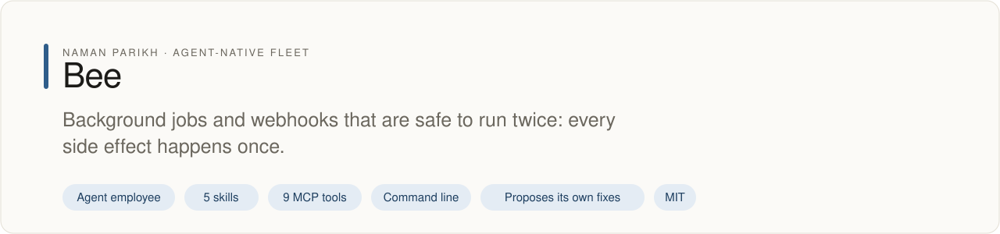
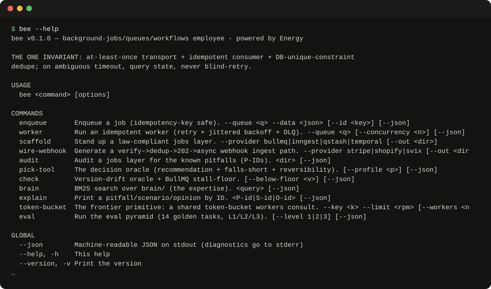

# bee

<!-- fleet:header:start -->
<p align="center"><picture><source media="(prefers-color-scheme: dark)" srcset="assets/banner-dark.svg"></picture></p>

<p align="center">
<a href="https://github.com/naman10parikh/bee/actions/workflows/ci.yml"></a>
<a href="https://github.com/naman10parikh/bee/releases"></a>
<a href="LICENSE"></a>
<a href="#use-it-from-any-coding-agent"></a>
<a href="https://x.com/naman10parikh"></a>
<a href="https://www.linkedin.com/in/naman-parikh1/"></a>
</p>

<p align="center"><a href="#quick-start">Quick start</a> · <a href="docs/README.md">How it works</a> · <a href="AGENTS.md">AGENTS.md</a> · <a href="llms.txt">llms.txt</a> · <a href="skills/">Skills</a> · <a href="https://github.com/naman10parikh/bee/discussions">Discussions</a> · <a href="https://github.com/naman10parikh">All projects</a></p>

**Background jobs and webhooks that are safe to run twice: every side effect happens once.**

Bee is an agent employee, a packaged specialist agent with its own skills, memory and tests. It owns one job: jobs, queues and webhooks. Coding agents use it through its skills, its MCP server and its command line. A scheduled job runs its evals and proposes fixes. A person makes every change.

_Bee is part of an agent-native play for agent-native systems that can eventually be recursively self-improving and evolving, operated by agent employees._

<p align="center"></p>
<!-- fleet:header:end -->

## What it is

bee is an agent employee for background work: the slow, risky jobs that run after a request returns, such as
charging a card, sending an email or handling a webhook. It builds and audits that layer for coding agents and
holds one rule: delivery happens at least once, so every side effect needs an idempotency key that a database
unique constraint enforces. It is for teams whose agents write job, queue and webhook code and cannot afford a
double charge or a retry storm.

<!-- fleet:use:start -->
## Use it from any coding agent

**Claude Code**: the plugin brings the skills, sub-agents, hooks and MCP server.

```
/plugin marketplace add naman10parikh/bee
/plugin install bee@bee
```

<details><summary>Its MCP server, Codex, Cursor, Gemini CLI, one skill and the command line</summary>

**Its MCP server**, in any MCP client:

```bash
claude mcp add --transport stdio bee -- npx -y -p github:naman10parikh/bee bee-mcp
codex mcp add bee -- npx -y -p github:naman10parikh/bee bee-mcp
```

Cursor (`.cursor/mcp.json`), Gemini CLI (`.gemini/settings.json`) and most other clients take the same command as JSON:

```json
{
  "mcpServers": {
    "bee": {
      "command": "npx",
      "args": [
        "-y",
        "-p",
        "github:naman10parikh/bee",
        "bee-mcp"
      ]
    }
  }
}
```

**Gemini CLI**: the extension brings the context and the MCP server.

```bash
gemini extensions install https://github.com/naman10parikh/bee
```

**One skill** (5 in all, in [skills/](skills/)), in any agent that reads Agent Skills:

```bash
gemini skills install https://github.com/naman10parikh/bee --path skills/idempotent-side-effects
git clone --depth 1 https://github.com/naman10parikh/bee /tmp/bee && cp -r /tmp/bee/skills/idempotent-side-effects ~/.claude/skills/
```

**The command line:**

```bash
npx -y -p github:naman10parikh/bee bee --help
```

</details>

Codex, Cursor, OpenCode, GitHub Copilot and other agents read [AGENTS.md](AGENTS.md); Claude Code reads [CLAUDE.md](CLAUDE.md) and Gemini CLI reads [GEMINI.md](GEMINI.md), which import it. [llms.txt](llms.txt) maps every surface for agents that read first.
<!-- fleet:use:end -->

## Quick start

You need Node.js 22 or later, pnpm, and Redis for the queue commands (`redis-server`, or
`docker run -p 6379:6379 redis:7`).

```bash
git clone https://github.com/naman10parikh/bee && cd bee
pnpm install

# Audit a jobs layer with seeded bugs: 13 findings, each keyed by its pitfall ID (exits 2 on high severity)
node bin/bee.js audit eval/fixtures/broken-jobs

# Ask which tool fits a serverless app; the answer names its weak spot and how hard it is to undo
node bin/bee.js pick-tool --profile serverless

# Look up a pitfall by ID, or search the brain
node bin/bee.js explain P-X5
node bin/bee.js brain "dedup ttl retry window"

# The core path (needs Redis): the same idempotency key twice is queued once, then processed once
node bin/bee.js enqueue --queue charges --data '{"amount":100}' --id charge-1 --json
node bin/bee.js enqueue --queue charges --data '{"amount":100}' --id charge-1 --json
node bin/bee.js worker --queue charges --drain --json

# Run the 14 golden evals, then the acceptance gate against Redis
pnpm test && pnpm acceptance
```

The second `enqueue` prints `"deduped":true`, and the worker reports `"processed":1` and `"effects":1`.
`REDIS_URL` points the queue commands at another Redis (the default is `redis://localhost:6379`).

## How it works

- **The rule.** Delivery is at least once, the consumer is idempotent, and the dedupe store keeps a key for
  longer than the provider's longest retry window. Every side effect carries a key derived from data that never
  changes, and a `UNIQUE` constraint makes a second run a no-op. On an ambiguous timeout, bee checks state
  instead of retrying.
- **The core path.** `enqueue` and `worker` run on BullMQ and Redis, with BullMQ pinned exactly to 5.78.1, the
  release that fixes a stall loop. The worker retries with jittered backoff, caps the attempts, and moves a
  poison job to a dead-letter queue you can redrive. A local SQLite ledger holds the dedupe keys and an audit row
  for each job.
- **The knowledge.** `brain/` holds 28 opinions, the known pitfalls and 20 battle-tested scenarios, each with an
  ID. `bee brain` ranks them with BM25, `bee explain` prints one by ID, and `bee audit` finds the pitfalls in
  real code.
- **The other commands.** `scaffold` writes a jobs layer from a reference baseline (BullMQ by default, with
  Inngest, QStash and Temporal templates). `wire-webhook` writes the verify, dedupe, 202 and process-later path
  for Stripe, Shopify or Svix. `check` compares the pins with the npm registry. `token-bucket` simulates one rate
  limit shared by every worker, which no vendor solves yet.
- **The surfaces.** The `bee` CLI, an MCP server (`bee-mcp`) whose 9 tools call the CLI with `--json`, 5 skills,
  2 reviewer sub-agents, and a local cockpit (`bash scripts/serve.sh`, then open http://localhost:7777).
- **The hooks.** One blocks a floating `^` or `~` range on a queue library in `package.json`.
  The other blocks a doc line that says "exactly-once" without the word "effect": bee promises an exactly-once effect, never delivery.
- **What it leaves to others.** HTTP-edge rate limits and caching, billing logic, database schema design, auth
  and deploys belong to other agent employees. bee uses a unique constraint; it does not design schemas.

bee is built on the Energy harness formula; the table below maps each part to its files.

<!-- fleet:anatomy:start -->
## What it is made of

Every project in this fleet is graded on the same 11 harness components and on self-improvement. Each mark is backed by a file you can open.

| Component | Grade | Where |
| --- | --- | --- |
| Identity | ✅ | identity/SOUL.md:9 |
| Memory | ✅ | MEMORY.md:1, src/backend/brain/bm25.js:33, memory/LEARNINGS.md:5 |
| Skills | ✅ | skills/idempotent-side-effects/SKILL.md:1 (5 skills) |
| Tools/CLIs | ✅ | package.json:7, bin/bee.js:1 |
| Hooks | ✅ | .claude/settings.json:4, hooks/hooks.json:4 |
| Sub-agents | ✅ | .claude/agents/idempotency-auditor.md:2, .claude/agents/durable-exec-reviewer.md:2 |
| MCPs | ✅ | src/backend/mcp/tools.js:47, package.json:8, .mcp.json:3 |
| Dispatch | ✅ | src/backend/dispatch/route.js:1, .github/workflows/rsi.yml:23 |
| Evals | ✅ | eval/runner.mjs:1, .github/workflows/ci.yml:61, .github/workflows/acceptance.yml:55 |
| Observability | ✅ | src/backend/obs/runlog.js:23 |
| Sandbox/Infra | ✅ | src/backend/sandbox/boot.mjs:151 |
| Self-improvement | ✅ | dsip.json:5, workflows/rsi.workflow.js:132, .github/workflows/rsi.yml:23 |

✅ real and tested · 🟡 partial, with the reason in the row · ❌ absent
<!-- fleet:anatomy:end -->

<!-- fleet:footer:start -->
## How it improves itself

It carries its own evals and a self-improvement contract, [`dsip.json`](dsip.json), which says what it may change and how a change is judged. A scheduled job runs its evals and proposes fixes. A person makes every change. Lessons it learns are kept as rules in its memory files.

## Part of a fleet

One of the projects by [Naman Parikh](https://github.com/naman10parikh). Each owns one part of an agent's harness, or of the product around an agent, and all of them follow one standard.

| Related project | What it owns |
| --- | --- |
| [AgentDial](https://github.com/naman10parikh/agentdial) | Identity |
| [WikiMem](https://github.com/naman10parikh/wikimem) | Memory |
| [Skillsmith](https://github.com/naman10parikh/skillsmith) | Skills |
| [Agent Booster](https://github.com/naman10parikh/agent-booster) | Tools / CLIs |
| [Armory](https://github.com/naman10parikh/armory) | MCPs and the component registry |
| [AgentGrid](https://github.com/naman10parikh/agentgrid) | Dispatch |
| [AgentSwarm](https://github.com/naman10parikh/agentswarm) | Dispatch |
| [AgentBench](https://github.com/naman10parikh/agentbench) | Evals |
| [AgentMoney](https://github.com/naman10parikh/agentmoney) | Observability |
| [Claude Harness](https://github.com/naman10parikh/claude-harness) | The whole harness, as a template |

## Community

Questions and ideas go to [Discussions](https://github.com/naman10parikh/bee/discussions); bugs go to [issues](https://github.com/naman10parikh/bee/issues/new/choose). Follow the work on [X](https://x.com/naman10parikh) and [LinkedIn](https://www.linkedin.com/in/naman-parikh1/).

## Contributing and security

Read [CONTRIBUTING.md](CONTRIBUTING.md). AI-assisted pull requests are welcome. Report a vulnerability privately, as [SECURITY.md](SECURITY.md) explains.

## License

MIT, © 2026 Naman Parikh. See [LICENSE](LICENSE) and [NOTICE](NOTICE).
<!-- fleet:footer:end -->
