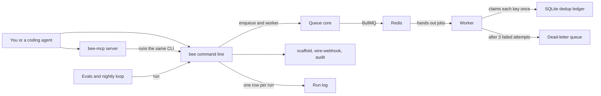

# How Bee works

Bee is a background jobs helper for developers and coding agents.
A background job is work an app hands off to run later, such as charging a card after an order.
Queues deliver each job at least once, so the same job can arrive twice.
Bee's rule is that a repeated job still takes effect only once.
It runs jobs on BullMQ, a job queue that keeps its state in Redis.
It also writes starter code for four job tools, and for webhooks, the messages a service such as Stripe sends your app.
It audits job code for known mistakes and helps you pick a tool.
No command calls a model or needs a key. The queue commands need a Redis server.

## The parts



The command line is [bin/bee.js](../bin/bee.js), plain JavaScript that runs on Node 22 with no build step.
It looks up one of eleven commands in its `COMMANDS` table and loads only that module from [src/backend/commands/](../src/backend/commands/).
[src/backend/cli/output.js](../src/backend/cli/output.js) prints text, or JSON with `--json`, and exits non-zero on an error.
The MCP server in [src/backend/mcp/server.js](../src/backend/mcp/server.js) offers 9 tools over standard input and output.
MCP, the Model Context Protocol, lets an agent call tools by name.
Each tool in [src/backend/mcp/tools.js](../src/backend/mcp/tools.js) turns its arguments into a `bee` command and runs it with `--json`.

[src/backend/queue.js](../src/backend/queue.js) adds jobs to BullMQ and runs the worker.
The worker claims each job in [src/db/dedup.js](../src/db/dedup.js), a SQLite table keyed by the job's idempotency key.
An idempotency key names one piece of work, so a repeat of that work can be spotted.
Retry delays come from [src/backend/backoff.js](../src/backend/backoff.js).
A job that fails every attempt moves to a dead-letter queue, a separate queue that keeps it for inspection.
The generators in [src/backend/scaffold/](../src/backend/scaffold/) and [src/backend/webhook/](../src/backend/webhook/) write starter code from templates.
[src/backend/audit/](../src/backend/audit/) scans job code with 11 detectors, each tied to a pitfall in [brain/KNOWN-PITFALLS.md](../brain/KNOWN-PITFALLS.md).
Every run appends one row to `logs/runs.jsonl` through [src/backend/obs/runlog.js](../src/backend/obs/runlog.js).

Bee also ships as a Claude Code plugin, with five skills in [skills/](../skills/) and two hooks in [hooks/hooks.json](../hooks/hooks.json).
One hook blocks a loose version range for a queue library in `package.json`.
The other blocks the phrase exactly-once in a Markdown file unless the word effect is on the same line.

## What happens when you run it

The main flow adds the same job twice, then runs a worker:

```bash
bee enqueue --queue orders --id order-42 --data '{"charge":100}'
bee enqueue --queue orders --id order-42 --data '{"charge":100}'
bee worker --queue orders --drain
```

1. [bin/bee.js](../bin/bee.js) reads the command name, starts a run record and loads [src/backend/commands/enqueue.js](../src/backend/commands/enqueue.js).
2. `enqueue` checks that `--queue` is set and that `--data` is valid JSON.
3. `deriveKey` in [src/backend/queue.js](../src/backend/queue.js) uses `--id` as the idempotency key. Without `--id`, it builds the key from a SHA-256 hash of the data.
4. It connects to Redis at `--redis`, then `REDIS_URL`, then `redis://localhost:6379`. An unreachable Redis fails fast with a clear message.
5. It looks for a job with that key, then adds the job with the key as its job id. The second run finds the first job and reports `deduped: true`.
6. Each job gets three attempts, with jittered backoff between them. Jitter adds a random part to each retry delay, so failed jobs do not all retry at once.
7. `bee worker` calls `startWorker`, which opens a BullMQ worker and the SQLite ledger. The ledger lives at `--db`, a SQLite `DATABASE_URL`, or `.bee/dedup.sqlite`.
8. For each job, the worker inserts the key into the ledger with `ON CONFLICT DO NOTHING`. Only the first insert counts as the effect. A repeat counts as deduped.
9. Each outcome also goes to an `audit_log` table and to a JSON line on standard error.
10. A job whose data has `"fail": true` throws on purpose, so tests can plant a poison job. After three failed attempts it moves to the `orders-dlq` queue.
11. With `--drain`, the worker stops when the queue is empty. It prints the processed, deduped and dead-lettered counts and the dead-letter queue depth.
12. When the process exits, [src/backend/obs/runlog.js](../src/backend/obs/runlog.js) appends the command, its duration and the outcome to `logs/runs.jsonl` in the bee folder.

The routing loop in [src/backend/dispatch/route.js](../src/backend/dispatch/route.js) runs this same flow after `bee scaffold`, in a temporary folder.
It passes only when the duplicate made one effect and the poison job reached the dead-letter queue.
In CI, [.github/workflows/acceptance.yml](../.github/workflows/acceptance.yml) runs [eval/acceptance.mjs](../eval/acceptance.mjs) against a `redis:7` service.

## Extending it

- **A command.** Add a module in [src/backend/commands/](../src/backend/commands/) whose default export is `run({ flags })`. Add it to `COMMANDS` and the help text in [bin/bee.js](../bin/bee.js).
- **An MCP tool.** Add an entry to `TOOLS` in [src/backend/mcp/tools.js](../src/backend/mcp/tools.js). Give it a name, a description, an input schema and an `argv` function that maps its arguments to a `bee` command.
- **An audit detector.** Add it to `DETECTORS` in [src/backend/audit/detectors.js](../src/backend/audit/detectors.js), keyed by its pitfall in [brain/KNOWN-PITFALLS.md](../brain/KNOWN-PITFALLS.md). The broken code in [eval/fixtures/broken-jobs/](../eval/fixtures/broken-jobs/) is what the evals audit.
- **A generator.** Add a template to [src/backend/scaffold/templates/](../src/backend/scaffold/templates/) or [src/backend/webhook/templates/](../src/backend/webhook/templates/). Register it in the `PROVIDERS` map of that folder's `index.js`.
- **A skill.** Create `skills/<name>/SKILL.md` with `name` and `description` front matter, like [skills/retry-and-backoff/SKILL.md](../skills/retry-and-backoff/SKILL.md).
- **An eval.** Add a golden task module to [eval/](../eval/), like [eval/g05_retry_jitter.mjs](../eval/g05_retry_jitter.mjs). It exports an id, a level, a `ciBlocking` flag, its brain ids in `sids`, a title and a `run` function. Add it to `TASKS` in [eval/runner.mjs](../eval/runner.mjs).

Run these before you push:

```bash
pnpm install
pnpm build
pnpm test
pnpm acceptance
pnpm exec playwright test
```

`pnpm build` type-checks the JavaScript with TypeScript and writes no files.
`pnpm acceptance` needs a Redis server at `REDIS_URL`.

## Questions

**Does it need an API key or cost money?**
No key is needed for any command, the MCP server, the evals or the acceptance test.
The queue commands need a Redis server, on your machine or one you run.
The optional sandbox run in [src/backend/sandbox/boot.mjs](../src/backend/sandbox/boot.mjs) boots an E2B machine with `E2B_API_KEY`, on your own E2B account.
Without that key it prints a skipped note and exits 0.

**Does any data leave the machine?**
`enqueue` and `worker` send job data to the Redis server at `REDIS_URL`, which is local by default.
`bee check` asks the npm registry for the latest version of each pinned package.
The sandbox run starts Redis and a BullMQ worker inside an E2B machine.
The cockpit in [web/server.mjs](../web/server.mjs) serves read-only pages on port 7777 by default.
It sets no host, so it listens on all network interfaces.

**How does it improve itself?**
[dsip.json](../dsip.json) declares the `agent` level, with a nightly loop and no self-grading.
[.github/workflows/rsi.yml](../.github/workflows/rsi.yml) runs `node workflows/rsi.workflow.js --deterministic` every day at 09:17 UTC.
The loop runs `bee check`, which compares six pinned package versions in [src/backend/check/index.js](../src/backend/check/index.js) with npm.
It then runs eval levels 1 and 2.
It also runs the token bucket simulation, which checks that many workers sharing one rate limit stay under it.
It writes version proposals to `logs/rsi/proposal-latest.json`, and CI uploads them for a person to review.
The loop never commits. The model half that would act on proposals is not built yet.

**How do I run its tests or evals?**
`pnpm test` and `pnpm eval` both run [eval/runner.mjs](../eval/runner.mjs), the 14 golden tasks. They need no Redis.
They exit 1 if any task fails. `bee eval --level 1`, `2` or `3` runs one level.
`pnpm acceptance` checks that a duplicate job makes one effect, that retries use jitter and that a poison job is dead-lettered.
It also kills a worker mid-run and races two workers on one key. The duplicate, kill and race checks run three times by default.
`pnpm exec playwright test` runs the cockpit tests in [tests/](../tests/), and uses Redis when one is reachable.

**What does it not do?**
The worker runs none of your job code. Its effect is the row it claims in the ledger, which proves the pattern.
`scaffold` and `wire-webhook` write starter code for you to adapt. Bee does not run Inngest, QStash or Temporal itself.
No command moves a job back out of the dead-letter queue yet.
The token bucket is a simulation by default. With `--redis` it grants or denies one token from a shared bucket. The code says never to present it as solved.
